<a href="https://guicardilho.com">
  <picture>
    <source media="(prefers-color-scheme: dark)" srcset="assets/banner-dark.svg" />
    <source media="(prefers-color-scheme: light)" srcset="assets/banner-light.svg" />
    
  </picture>
</a>

 

Desenvolvedor Full Stack em São Paulo, com experiência em sistemas de pagamento, integrações, CRM e plataformas de atendimento.

  <a href="https://guicardilho.com"><picture><source media="(prefers-color-scheme: dark)" srcset="assets/link-site-dark.svg" /><source media="(prefers-color-scheme: light)" srcset="assets/link-site-light.svg" /></picture></a>
  <a href="https://linkedin.com/in/guilherme-cardilho"><picture><source media="(prefers-color-scheme: dark)" srcset="assets/link-linkedin-dark.svg" /><source media="(prefers-color-scheme: light)" srcset="assets/link-linkedin-light.svg" /></picture></a>
  <a href="mailto:gui_cardilho@hotmail.com"><picture><source media="(prefers-color-scheme: dark)" srcset="assets/link-email-dark.svg" /><source media="(prefers-color-scheme: light)" srcset="assets/link-email-light.svg" /></picture></a>

## Hoje

- **Noktaro · Founder**: desenvolvimento de software sob encomenda, incluindo design e programação.
- **ClickCannabis**: telemedicina. Sistemas para a operação e o atendimento, como o CRM e o chat ao vivo.
- **FastPay Brasil**: subadquirente. APIs e integrações das plataformas de pagamentos white-label e de faturamento global.

## Processo

  <picture>
    <source media="(prefers-color-scheme: dark)" srcset="assets/projeto-dark.svg" />
    <source media="(prefers-color-scheme: light)" srcset="assets/projeto-light.svg" />
    
  </picture>

Etapas em texto

 

1. **Levantamento**: ouvir os problemas.
2. **Apresentação** da ideia.
3. **Escopo**: o que entra.
4. **Fluxos**: jornada de quem usa.
5. **Protótipo** navegável.
6. **Planejamento**: etapas e prazos.
7. **Arquitetura**: serviços e dados.
8. **Ciclos**: desenvolver, testar, apresentar e ajustar, em entregas parciais.
9. **Homologação**: aceite do cliente.
10. **Entrega** em produção.
11. **Operação**: suporte e novas demandas.

O cliente valida em todas as etapas.

## Stack

  <picture>
    <source media="(prefers-color-scheme: dark)" srcset="assets/stack-dark.svg" />
    <source media="(prefers-color-scheme: light)" srcset="assets/stack-light.svg" />
    
  </picture>

Todas as tecnologias

 

- **Principal**: TypeScript, Node.js, NestJS, React, Next.js, PostgreSQL, Redis, Docker
- **Back-end**: Fastify, Express, Prisma, MongoDB, RabbitMQ, Python, PHP
- **Front-end**: Vue, Tailwind CSS, Sass
- **Infra e ferramentas**: AWS, Azure, GitHub Actions, Linux, Nginx, Jest, Sentry, Figma, Postman

English

 

Full Stack Developer based in São Paulo, experienced in payment systems, integrations, CRM and live chat platforms.

**Today**

- **Noktaro · Founder**: custom software development, including design and programming.
- **ClickCannabis**: telemedicine. Systems for operations and customer service, such as the CRM and the live chat.
- **FastPay Brasil**: payment sub-acquirer. APIs and integrations for the white-label payments and global billing platforms.

**Process**

1. **Discovery**: listening to the problems.
2. **Pitch**: presenting the idea.
3. **Scope**: what goes in.
4. **Flows**: the journey of the people who will use it.
5. **Prototype**, clickable.
6. **Planning**: stages and deadlines.
7. **Architecture**: services and data.
8. **Cycles**: build, test, present and adjust, in partial deliveries.
9. **Staging**: client sign-off.
10. **Delivery** to production.
11. **Operation**: support and new requests.

The client validates at every stage.

**Stack**

- **Main**: TypeScript, Node.js, NestJS, React, Next.js, PostgreSQL, Redis, Docker
- **Back end**: Fastify, Express, Prisma, MongoDB, RabbitMQ, Python, PHP
- **Front end**: Vue, Tailwind CSS, Sass
- **Infrastructure and tools**: AWS, Azure, GitHub Actions, Linux, Nginx, Jest, Sentry, Figma, Postman

 

<picture>
  <source media="(prefers-color-scheme: dark)" srcset="https://raw.githubusercontent.com/GuiCardilho/GuiCardilho/output/github-snake-dark.svg" />
  <source media="(prefers-color-scheme: light)" srcset="https://raw.githubusercontent.com/GuiCardilho/GuiCardilho/output/github-snake.svg" />
  
</picture>
